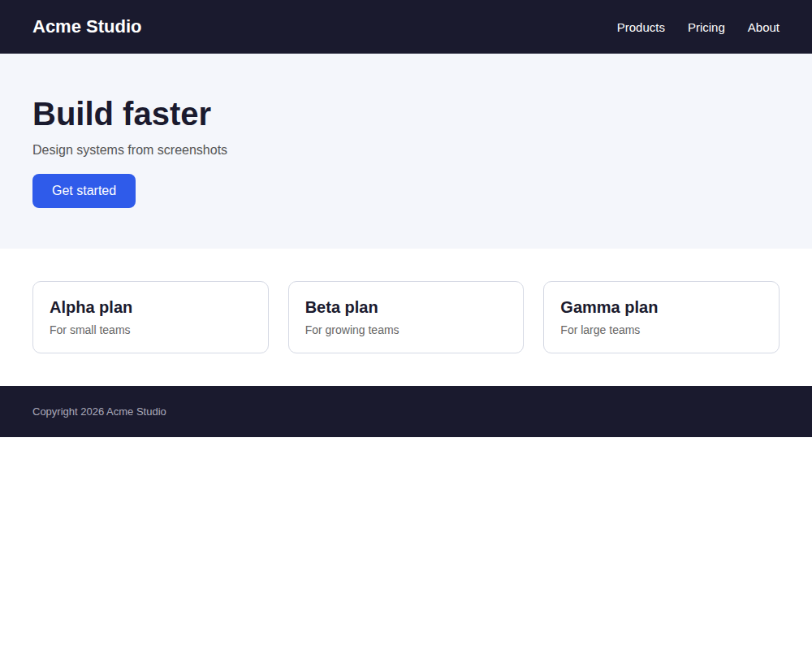
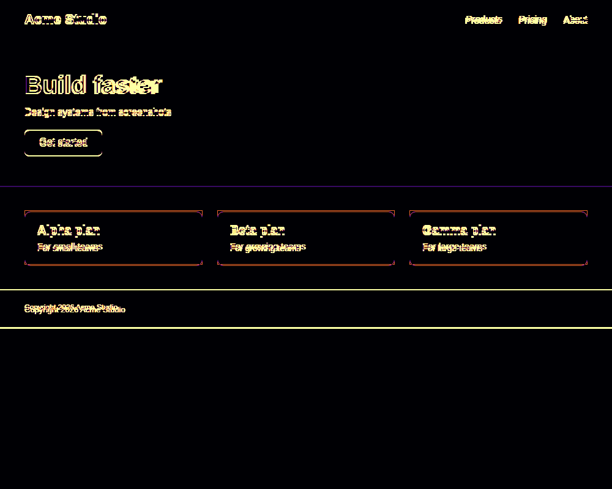

# Screen2Code

**See it. Understand it. Rebuild it.**

Screen2Code is an open-source UI reverse-engineering tool. It turns screenshots into an explicit, evidence-aware, framework-independent interface representation (IR), generates editable HTML/CSS or React output, renders static HTML in a restricted Chromium session, and measures the result against the reference. It is not an "image → LLM → HTML" wrapper: perception is based on computer vision and OCR, and inferred properties retain links to their supporting measurements.

> **Project stage:** public-source preview / 0.1.0 development release. The Python engine, CLI, sidecar, and web UI are implemented. The Tauri desktop shell has been compiled and launched in Windows development mode by the maintainer; a packaged installer, signed sidecar, and production release pipeline are not available yet. See [Status](docs/STATUS.md).

| Reference screenshot | Generated, rendered | Overlay | Difference |
|---|---|---|---|
|  |  |  |  |

*Example output from `screen2code run tests/fixtures/landing.png`. This is an authored fixture, not a third-party website. The committed baseline reports SSIM 0.923, edge F1 0.882, layout IoU 0.878, and 18/18 matched nodes. Synthetic/fixture results are not a claim of equivalent performance on arbitrary websites.*

## What is implemented

| Area | Current status |
|---|---|
| Screenshot import, CV/OCR perception, measurement and reconstruction | Implemented; classical CV + Tesseract baseline |
| Versioned IR, validation, canonical serialization and migration | Implemented |
| Multi-screenshot responsive reconciliation | Implemented with explicit fallback when correspondence is uncertain |
| HTML/CSS generation | Implemented |
| React generation | Experimental; generate-only, not built or executed by Screen2Code |
| Static rendering and visual evaluation | Implemented; JavaScript disabled and network blocked |
| Measured refinement | Implemented; changes committed IR only with explicit `--apply` |
| Text redaction | Implemented for recognized text only; source pixels and raster assets remain |
| CLI, Python API and JSON-RPC sidecar | Implemented |
| React + TypeScript desktop web UI | Implemented and tested against the real sidecar |
| Tauri desktop shell | Compiled and launched in Windows development mode; packaging and installer not completed |
| Signed Windows sidecar / installer / macOS app | Not available |

See [docs/STATUS.md](docs/STATUS.md) for evidence, test coverage, limitations, and verification boundaries.

## Quick start

Requirements: Python 3.11+, Tesseract 5 with English data, and Chromium installed through Playwright.

```bash
python -m venv .venv
# Linux/macOS
. .venv/bin/activate
# Windows PowerShell: .venv\Scripts\Activate.ps1

python -m pip install -r requirements-lock.txt
python -m pip install -e . --no-deps
python -m playwright install chromium
screen2code doctor
screen2code run tests/fixtures/landing.png --project demo.s2c
```

If `doctor` reports that Chromium's sandbox is unavailable, rendering fails closed. You can explicitly opt in with `screen2code --allow-no-sandbox run ...`; the waiver is recorded. JavaScript remains disabled and network access remains blocked. Do not disable the sandbox casually.

Outputs are written to the project directory: `ir/project.ir.json`, `exports/html/`, `renders/`, and `evaluations/`.

For multiple screenshots of one page at different widths:

```bash
screen2code import demo.s2c home-1000.png --page home --viewport-width 1000
screen2code import demo.s2c home-480.png --page home --viewport-width 480
screen2code reconstruct demo.s2c
```

To remove recognized text from the IR and generated exports, use `screen2code --redact-text reconstruct ...`. This does **not** mask the original screenshot or extracted raster assets. A redacted project is not automatically safe to share.

## Desktop UI

The React/TypeScript web UI communicates with the local `screen2code serve` JSON-RPC sidecar. To build and test the web bundle:

```bash
npm install --prefix ui
npm run --prefix ui typecheck
python scripts/build_ui.py
python -m unittest tests.test_ui
```

The Tauri shell is in `src-tauri/`. Development-mode compilation and launch have been verified on Windows, but a packaged installer, signed sidecar executable, code signing, and automated packaged-app tests are not provided. Follow [docs/INSTALL.md](docs/INSTALL.md) and read the status notes before treating it as a distributable desktop app.

## Documentation

- [Installation](docs/INSTALL.md)
- [CLI reference](docs/CLI.md) · [Python API](docs/PYTHON_API.md)
- [IR specification](docs/IR_SPEC.md) · [Architecture](docs/ARCHITECTURE.md)
- [Security model](docs/SECURITY.md) · [Security reporting](SECURITY.md)
- [Benchmarks](docs/BENCHMARKS.md) · [Status and verification](docs/STATUS.md)
- [Contributing](CONTRIBUTING.md) · [Changelog](CHANGELOG.md)

## Security and privacy

Screenshots, provider output, IR data, and generated code are untrusted. Writes are confined to project directories; imports are validated; static HTML rendering disables JavaScript and blocks network access. Screen2Code does not build or execute generated projects. There is no telemetry and no automatic upload. Review [docs/SECURITY.md](docs/SECURITY.md) before using the tool with sensitive material.

## License

MIT. See [LICENSE](LICENSE) and [THIRD_PARTY_LICENSES.md](THIRD_PARTY_LICENSES.md).
